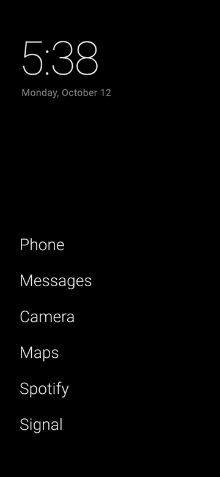
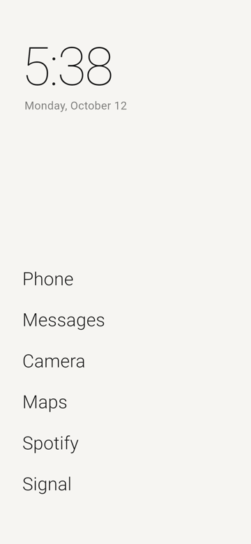
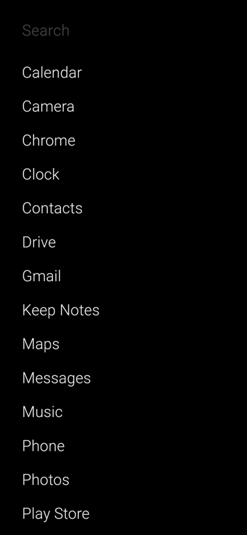
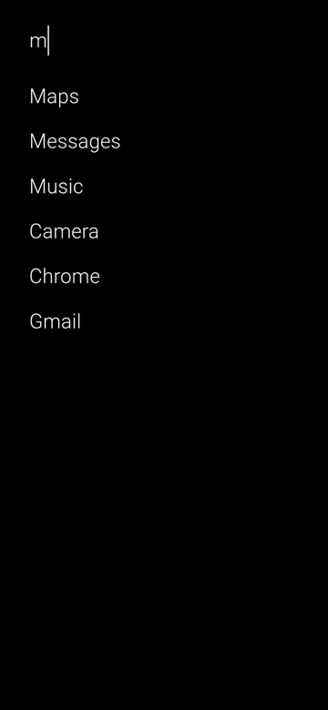
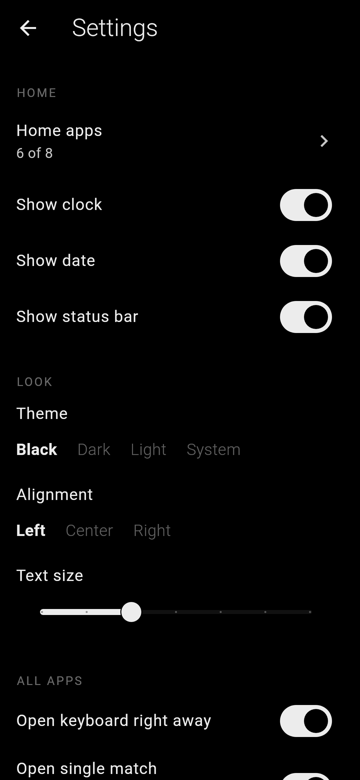

# Launcher

A minimalist, text-only Android home screen built with Flutter. No icons, no
wallpaper and no widgets. It shows the time, the date and the few apps you
actually use.

<p>
  
  
  
  
  
</p>

## Using it

| Do this | To get this |
| --- | --- |
| Tap an app | Open it |
| Swipe up | All apps, with the keyboard ready to search |
| Type until one app is left | That app opens on its own |
| Press Enter in search | Open the top match, or search the web if nothing matches |
| Pull down at the top of All apps | Back home |
| Long-press an app | Add to or remove from home, rename, hide, app info, uninstall |
| Long-press empty space | Settings |
| Swipe left | Phone |
| Swipe right | Camera |
| Swipe down | Notifications |
| Double tap | Lock the screen |
| Tap the clock or the date | Alarms or calendar |

Every swipe and the double tap can be changed in Settings → Gestures to open
any app, or to do nothing.

**Double tap to lock.** Android only lets a launcher lock the screen through
an accessibility service. The first time you double tap, Launcher sends you to
Settings → Accessibility to turn on *Launcher: double tap to lock*. The
service listens to no events and reads no screen content.

## Why it's light on battery

- **Pure black by default.** On OLED screens black pixels are switched off.
- **Nothing animates while idle.** The clock redraws once a minute, on the
  minute, and stops completely while another app is open.
- **No icons.** Nothing gets decoded, cached or kept in memory.
- **No background work.** App installs and removals come from Android's
  `LauncherApps` callbacks instead of polling.
- **Small.** It has one dependency (`shared_preferences`). Everything else
  goes through a small Kotlin bridge in `MainActivity.kt`.

## Build and install

You need Flutter 3.47 or newer and the Android SDK.

```sh
flutter build apk --release --split-per-abi
adb install build/app/outputs/flutter-apk/app-arm64-v8a-release.apk
```

The first time you open it, Launcher offers to become your home screen. Tap
**Set as default** and confirm in Android's dialog. Until you do, the home
button keeps going back to your old launcher. You can do this later from
Launcher's settings, or from Android's Settings → Apps → Default apps → Home
app. Install a release build: debug builds are much
slower and use more battery.

The release build is signed with the debug key. Add your own signing config
in `android/app/build.gradle.kts` before publishing it anywhere.

## Code map

```
lib/
  main.dart            app root, theme switching, status bar
  apps.dart            app model, app list, search ranking
  settings.dart        everything the user can change, saved on every write
  native.dart          Dart side of the platform channel
  theme.dart           black, dark and light monochrome themes
  ui/home_screen.dart  clock, home apps, gestures
  ui/drawer_screen.dart  all apps and search
  ui/settings_screen.dart  settings, home apps order, hidden apps
android/app/src/main/kotlin/com/kidyoh/launcher/
  MainActivity.kt      lists and launches apps, intents, home button
  LockService.kt       accessibility service used only to lock the screen
```

Run the tests with `flutter test`.
